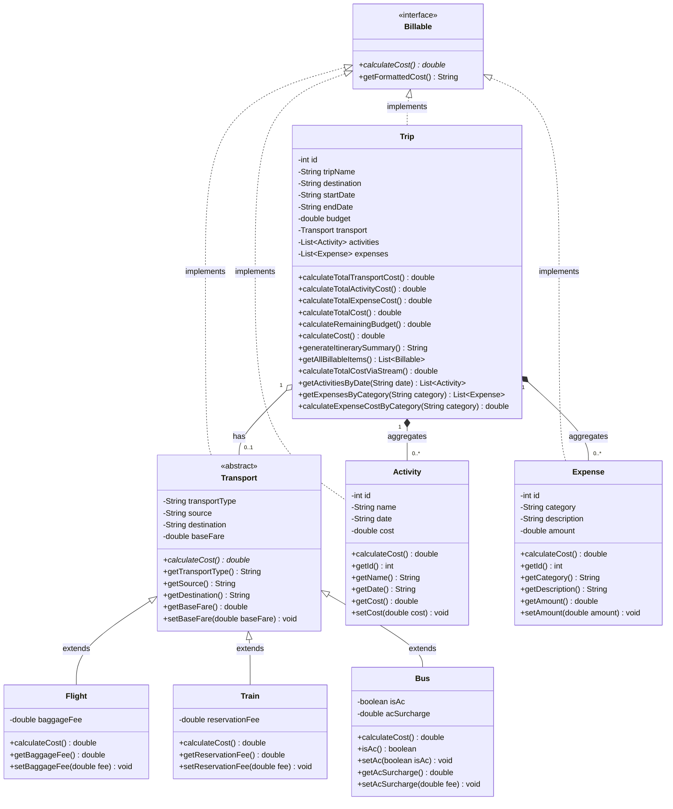
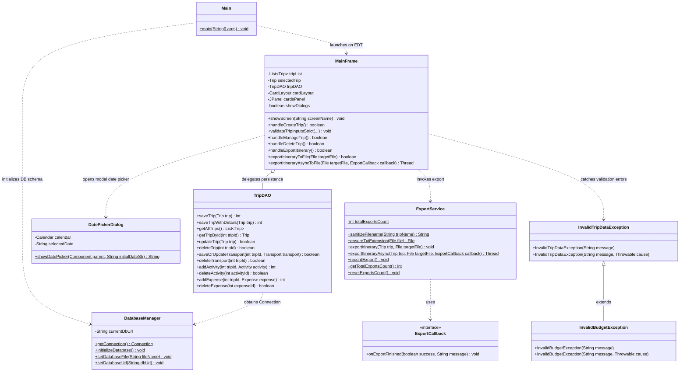
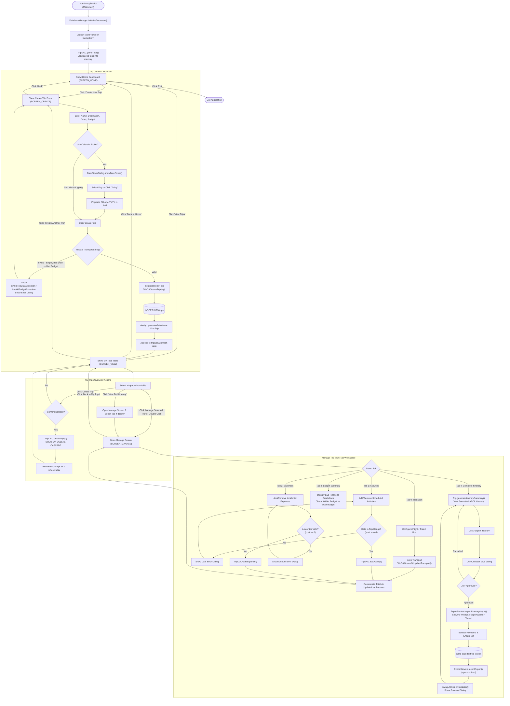

# VoyageX — Desktop Travel Planner & Itinerary Manager

> **Current Implementation:** VoyageX is a fully functional desktop travel planner and itinerary management application built with **Core Java 8** and **Java Swing/AWT**, persisting to a local **SQLite** database via pure **JDBC**. This repository reflects the complete implementation through **Phase 7**, including the Back to Home navigation improvement.

---

## 1. Project Overview

**VoyageX** is a beginner-friendly yet architecturally robust desktop travel management tool developed for an undergraduate Java semester project. It allows travelers to plan trips, select polymorphic transportation options (Flight, Train, or Bus), schedule dated activities, track categorized incidental expenses, monitor budgets in real-time with over-budget alerts, generate formatted text itineraries, and export them safely to disk.

---

## 2. Key Features

- **Trip Management:** Create, browse, manage, and delete trips with confirmation dialogs and cascading database deletions.
- **Polymorphic Transportation:** Choose between Flight (with baggage fees), Train (with reservation fees), and Bus (with AC surcharge options), with runtime polymorphic fare calculations.
- **Activities & Expenses:** Schedule activities with calendar date validation and log categorized expenses (`Food & Dining`, `Lodging`, `Shopping`, `Local Transport`, `Sightseeing`, `Emergency`, `Other`).
- **Interactive Calendar Picker:** Lightweight, dependency-free modal calendar popup (`DatePickerDialog`) with month/year navigation, quick "Today" selection, and strict `dd-MM-yyyy` validation.
- **Real-Time Budget Tracking:** Dynamic financial breakdown showing transport, activities, expenses, grand total, and remaining balance with live visual health banners (`WITHIN BUDGET` vs `OVER BUDGET`).
- **Complete Itinerary View:** Formatted ASCII summary consolidating all trip metadata, route details, schedules, and costs into a monospaced view.
- **Safe Text File Export:** Plain-text `.txt` export with filename sanitization (stripping illegal filesystem characters), defensive extension handling, and asynchronous background worker thread execution.
- **SQLite Database Persistence:** Standalone relational storage in `voyagex.db` via JDBC with foreign key integrity, transaction rollback safety, and complete data survival across restarts.
- **Fluid Navigation:** Intuitive `CardLayout` screen transitions with dedicated **Back to Home** and **Back to My Trips** navigation buttons.

---

## 3. Technology Stack

- **Language:** Java SE 8 (compatible with JDK 8, 11, 17, and 21)
- **GUI Framework:** Java Swing (`javax.swing.*`) and AWT (`java.awt.*`)
- **Database Engine:** SQLite 3 (local file-based engine, `voyagex.db`)
- **Database Driver:** SQLite JDBC Driver 3.36.0.3 (`lib/sqlite-jdbc-3.36.0.3.jar`)
- **File I/O:** Standard `java.io` (`PrintWriter`, `BufferedWriter`, `FileWriter`, `File`)
- **Build / Dependency Tooling:** Pure JDK commands (`javac`, `java`); zero external build tools required.

---

## 4. Architecture Overview

VoyageX follows a clean layered design separating presentation, business logic, persistence, and domain entities:

- **Presentation Layer (`ui/`):** `MainFrame` manages screen switching via `CardLayout` (`HOME`, `CREATE`, `VIEW`, `MANAGE`), form inputs, tables, and dialogs. `DatePickerDialog` provides the modal calendar picker.
- **Domain Layer (`model/`, `interfaces/`):** Core entity models (`Trip`, `Transport`, `Flight`, `Train`, `Bus`, `Activity`, `Expense`) implementing `interfaces.Billable`.
- **Persistence Layer (`dao/`):** `DatabaseManager` handles connections and schema DDL; `TripDAO` performs parameterized CRUD operations and multi-table transactions.
- **Service Layer (`service/`):** `ExportService` handles file sanitization, text I/O, thread-safe counter tracking, and background worker threads (`Runnable`).

---

## 5. Repository Structure

All seven automated test files reside directly in the **project root** directory alongside `Main.java`:

```
VoyageX/
├── Main.java                       # Application entry point (EDT launch & DB init)
├── README.md                       # This repository entry point and guide
├── VIVA_NOTES.md                   # Comprehensive technical reference & viva prep
├── PROJECT_RULES.md                # Development scope and engineering rules
├── VoyageX_Java_Syllabus.md        # University course syllabus mapping
├── VoyageX_Mini_PRD_Team_Plan.md   # Architectural phase plan
├── voyagex.db                      # Local SQLite database (created automatically)
│
├── dao/                            # Database Access Object Layer
│   ├── DatabaseManager.java        # SQLite connection & schema initialization
│   └── TripDAO.java                # Full CRUD, transactions, and cascade deletions
│
├── exception/                      # Custom Exception Hierarchy
│   ├── InvalidTripDataException.java # Checked exception for trip validation
│   └── InvalidBudgetException.java   # Checked subclass for invalid budget/cost
│
├── interfaces/                     # Domain Contracts
│   └── Billable.java               # Interface for cost-bearing items with default method
│
├── lib/                            # External Libraries
│   └── sqlite-jdbc-3.36.0.3.jar    # Standalone SQLite JDBC driver
│
├── model/                          # Domain Models & OOP Hierarchy
│   ├── Activity.java               # Scheduled itinerary event (implements Billable)
│   ├── Bus.java                    # Bus travel subclass with AC surcharge
│   ├── Expense.java                # Incidental trip expense (implements Billable)
│   ├── Flight.java                 # Air travel subclass with baggage fee
│   ├── Train.java                  # Railway travel subclass with reservation fee
│   ├── Transport.java              # Abstract base class for transit modes
│   └── Trip.java                   # Central aggregate model, itinerary text, & Streams
│
├── service/                        # Service & Business Operations Layer
│   └── ExportService.java          # Plain-text export & async worker thread
│
├── ui/                             # Presentation Layer (Java Swing & AWT)
│   ├── DatePickerDialog.java       # Interactive modal calendar dialog
│   └── MainFrame.java              # Main desktop window & CardLayout controller
│
├── TestPhase1.java                 # Phase 1 test suite: Core OOP models & budget math (32 checks)
├── TestPhase2.java                 # Phase 2 test suite: Swing GUI, CardLayout, & DatePicker (41 checks)
├── TestPhase3.java                 # Phase 3 test suite: Transport, activities, expenses, budget (109 checks)
├── TestPhase4.java                 # Phase 4 test suite: Itinerary summary, date boundaries, sync (88 checks)
├── TestPhase5.java                 # Phase 5 test suite: File export, filename sanitization, I/O (44 checks)
├── TestPhase6.java                 # Phase 6 test suite: SQLite persistence, JDBC, cascade delete (98 checks)
└── TestPhase7.java                 # Phase 7 test suite: Billable, exceptions, Streams, threads (71 checks)
```

---

## 6. UML Class Diagram

The following class diagrams illustrate the object-oriented structure, contracts, and separation of concerns implemented in VoyageX.

### 6.1 Core Domain Models & OOP Hierarchy



### 6.2 Application Architecture, Persistence & Services



---

## 7. Application Flowchart

The flowchart below shows the end-to-end execution flow of VoyageX, including startup bootstrap, `CardLayout` screen navigation, input validation decision points, database persistence, and asynchronous file export:



---

## 8. Prerequisites

To compile, test, and run VoyageX, ensure you have:
- **Java Development Kit (JDK):** Version 8 or higher (tested with Oracle JDK / OpenJDK 8, 11, 17, and 21).
- **Operating System:** Windows, macOS, or Linux.
- **Terminal:** Windows PowerShell, Command Prompt, or bash.

Verify your Java installation:
```powershell
java -version
javac -version
```

---

## 9. Compilation Instructions

Open Windows PowerShell in the project root directory (`VoyageX/`) and run:

```powershell
javac -cp ".;lib/*" interfaces/*.java exception/*.java model/*.java dao/*.java service/*.java ui/*.java Main.java TestPhase1.java TestPhase2.java TestPhase3.java TestPhase4.java TestPhase5.java TestPhase6.java TestPhase7.java
```

*Note: On Linux or macOS, replace the semicolon with a colon in the classpath: `-cp ".:lib/*"`.*

---

## 10. Launching the Application

Run the application entry point using the SQLite JDBC driver on the classpath:

```powershell
java -cp ".;lib/*" Main
```

The application automatically initializes the SQLite database schema in `voyagex.db`, loads previously saved trips, and presents the Home dashboard on the Swing Event Dispatch Thread (EDT).

---

## 11. Running Automated Test Suites

VoyageX includes seven standalone regression test suites located in the project root, verifying **483 automated checks** across all development phases:

```powershell
# Phase 1: Core OOP Models, Inheritance, Polymorphism, Encapsulation (32 checks)
java -cp ".;lib/*" TestPhase1

# Phase 2: Swing GUI Window, CardLayout, DatePicker, Validation (41 checks)
java -cp ".;lib/*" TestPhase2

# Phase 3: Manage Trip Tabs, Transport Hierarchy, Activities, Budget (109 checks)
java -cp ".;lib/*" TestPhase3

# Phase 4: Itinerary Summary, Activity Date Boundaries, Dynamic Sync (88 checks)
java -cp ".;lib/*" TestPhase4

# Phase 5: Text File Export, Filename Sanitization, Disk I/O (44 checks)
java -cp ".;lib/*" TestPhase5

# Phase 6: SQLite Persistence, JDBC, Transactions, Cascade Deletion (98 checks)
java -cp ".;lib/*" TestPhase6

# Phase 7: Billable Interface, Custom Exceptions, Stream API, Threads (71 checks)
java -cp ".;lib/*" TestPhase7
```

**Automated Test Status:** `483 / 483 checks passed (100% PASS)`.

> **Note on Verification:** Automated test suites verify model calculations, input validation boundaries, database persistence transactions, Streams, and thread synchronization headlessly. Interactive GUI behaviors (such as visual styling, responsive resizing, and user clicking) are verified manually in the running desktop application.

---

## 12. Database Behavior & Storage

- **Database File:** SQLite stores all data locally in `voyagex.db` in the project root.
- **Schema Bootstrap:** Tables (`trips`, `transport`, `activities`, `expenses`) are automatically created if they do not exist when `Main` launches.
- **Foreign Keys:** Enabled on every connection (`PRAGMA foreign_keys = ON;`) to enforce relational integrity and enable `ON DELETE CASCADE`.
- **Git Status:** `voyagex.db` and temporary test databases are ignored by `.gitignore` to keep version control clean.

---

## 13. Dependency Setup

VoyageX requires exactly one standalone external JAR:
- **File:** `lib/sqlite-jdbc-3.36.0.3.jar`
- **Description:** Pre-packaged pure Java SQLite JDBC driver compatible with Java 8.
- **Git Tracking:** Explicitly un-ignored in `.gitignore` (`!lib/*.jar`) so anyone cloning the repository has everything needed to run immediately without Maven or Gradle.

---

## 14. Basic Usage Guide

1. **Dashboard:** From the Home screen, click **Create New Trip** or **View Trips**.
2. **Create a Trip:** Enter Trip Name, Destination, Start Date, End Date, and Budget. Use the **Pick...** button to select dates from the interactive calendar or type manually in `dd-MM-yyyy` format. Click **Create Trip**.
3. **Browse Trips:** The **My Trips** screen lists all saved trips.
   - Click **Manage Selected Trip** (or double-click a table row) to open the multi-tab management workspace.
   - Click **View Full Itinerary** to jump directly to the formatted itinerary view.
   - Click **Delete Trip** to permanently delete a trip and its associated details.
   - Click **Back to Home** to return immediately to the main dashboard.
4. **Manage Components:**
   - *Transport:* Select Flight, Train, or Bus, specify source/destination, base fare, and applicable fees (baggage, reservation, or AC surcharge). Click **Save Transport**.
   - *Activities:* Add scheduled events with dates strictly validated against the trip's date range.
   - *Expenses:* Log incidental costs with categories like Food, Lodging, or Shopping.
   - *Budget Summary:* Review real-time expenditure cards and budget health status.
5. **View & Export Itinerary:** Switch to the **Complete Itinerary** tab. Review the monospaced ASCII summary and click **Export Itinerary** to save a sanitized `.txt` file to disk.
6. **Return to Trips:** Click **Back to My Trips** on the bottom navigation strip to return to the trips overview table.

---

## 15. Current Limitations

- **Local Single-User Desktop:** Does not support cloud synchronization, remote database servers, or multi-user authentication.
- **Synchronous Database Calls:** Database queries execute synchronously on the calling thread.
- **Static Pricing Model:** Transport fares and costs are estimated entries rather than live booking API rates.
- **Export Format:** Itineraries export to plain text (`.txt`); PDF and HTML formats are not supported.